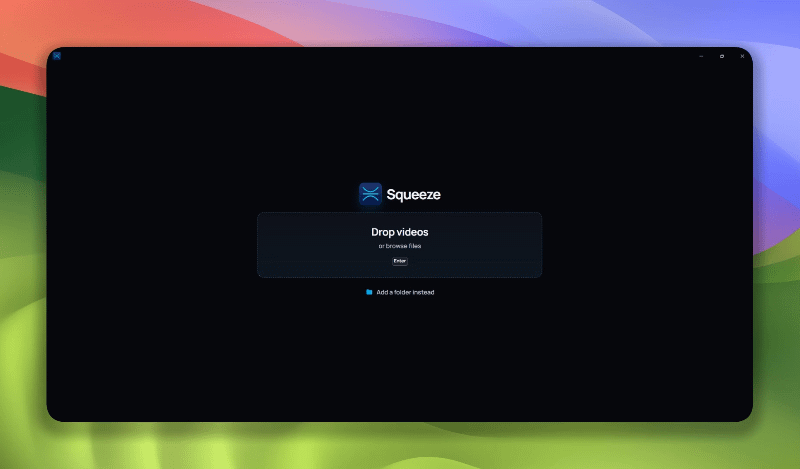

<div align="center">


# Squeeze

**Compress and trim videos locally. Fit a clip under upload limits, or free up disk space. Nothing is uploaded anywhere.**

<br />

<a href="https://getsqueeze.app"></a>
<a href="https://github.com/avalianiz/squeeze/releases/latest"></a>
<a href="https://github.com/avalianiz/squeeze/issues"></a>

___


<br />



</div>

<br />


## Why Squeeze?

Most "compress video" websites make you upload your files, ask for money, or slap a watermark on your video. Command line ffmpeg works great, but it is not the most user-friendly thing ever, especially for non-technical people.

Squeeze is a small desktop app that wraps ffmpeg. You pick a **target size** and it figures out the rest. 

## Features

- **Target-size compression**: pick 10 MB, 25 MB, 50 MB, or enter a custom size
- **Built-in trimmer**: trim the video before squeezing it
- **Live size estimate**: see the output size and savings before you hit Compress
- **Resolution and framerate controls**: Original / 1080p / 720p, Full / 60 / 30 fps
- **Batch queue**: add multiple videos and process them in one go
- **Mute audio**: strip the audio track in one click
- **Replace originals**: optionally overwrite the source after a successful encode
- **100% local**: your videos never leave your machine
- **Lightweight**: native app built with Rust and Tauri, no bundled browser, embedded ffmpeg binary is stripped down

## Installation

### Download
Visit [getsqueeze.app](https://getsqueeze.app), or
get  the latest installer from the [**Releases**](https://github.com/avalianiz/squeeze/releases/latest) page.

| Platform | File |
|---|---|
| Windows x64 | `Squeeze_*_x64-setup.exe` or `Squeeze_*_x64_en-US.msi` |
| macOS Apple Silicon | `Squeeze_*_aarch64.dmg` |
| macOS Intel | `Squeeze_*_x64.dmg` |
| Linux x64 | `Squeeze_*_amd64.AppImage` or `Squeeze_*_amd64.deb` |


> [!WARNING]
> Windows may show a SmartScreen "Unknown publisher" warning, and macOS may say the app is from an unidentified developer, until the installers are signed and notarized.

### Build from source

**Prerequisites:** [Node.js](https://nodejs.org) (LTS), [Rust](https://www.rust-lang.org/tools/install), and the [Tauri system dependencies](https://tauri.app/start/prerequisites/) for your OS.

```bash
git clone https://github.com/avalianiz/squeeze.git
cd squeeze
npm install
npm run setup:ffmpeg

# run in development
npm run tauri dev

# create a production build
npm run tauri build
```

## Usage

1. **Add videos** by dragging them into the window or clicking *Add videos*.
2. **Trim** (optional) by dragging the timeline handles to the part you want to keep.
3. **Choose settings**: resolution, framerate, and target size.
4. Click **Compress**. The finished file is saved next to the original, or replaces it if you enabled *Replace originals*.

> [!TIP]
> Need it small for a chat app? Start with the 10 MB or 25 MB presets and drop to 720p / 30 fps if the clip is long.

## How it works

Squeeze runs [ffmpeg](https://ffmpeg.org) under the hood. It reads your clip's duration, works out the video bitrate needed to land on your target size, and encodes with those settings. The UI is built with TypeScript and Vite, and the native shell is Rust with [Tauri](https://tauri.app).

## Contributing

<div align="center">


</div>

Contributions are welcome. Read [CONTRIBUTING.md](CONTRIBUTING.md) before you open a pull request. For larger changes, please open an issue first.

## License

Squeeze's own code is under the [MIT License](LICENSE).

Installers also include FFmpeg and x264, which are GPL-2.0-or-later, and the Manrope font, which is SIL OFL-1.1. The full list is generated into [`NOTICES.txt`](NOTICES.txt) with `npm run notices`.

<div align="center">

<br />

If Squeeze saved you some space, consider leaving a ⭐

Made by [@avalianiz](https://github.com/avalianiz)

</div>
